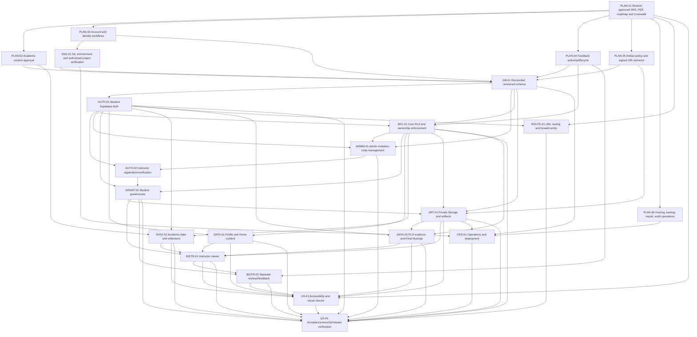

# Implementation Dependency Map

**Status:** Proposed sequencing derived from the verified assessment and backlog.  
**Roadmap phase mapping:** Unverified until `MASTER_PROJECT_ROADMAP.md` is restored. “Phase 7” appears only as a planning reference in the Phase 6 validation report.

## Dependency graph

## Sequencing notes

1. **Source and decisions first:** PLAN-01 must unblock content, policy and roadmap mapping. PLAN-02 through PLAN-06 can progress from available records, but any missing client authority remains a gate.
2. **Controlled backend foundation:** ENV-01 precedes DB-01. DB-01 is a review/migration planning task; applying schema to a shared or production project requires the relevant approval and safeguards.
3. **Authentication before user data:** AUTH-01 and trusted role provisioning precede account-owned content. Instructor registration and administrator management are separate tasks because their trust boundaries differ.
4. **RLS before feature integration:** SEC-01 protects database access; grants depend on authenticated identities and RLS. Storage also needs its own policy layer and must mirror ownership/grants.
5. **Feature slices remain separate:** Home/profile, reflections, PLO/Final Musings, files, instructor viewing and feedback are independent implementation tasks with explicit dependencies. Instructor viewing consumes student feature data; feedback depends on the approved revised model.
6. **Release operations are a gate:** OPS-01 is marked P3 for implementation sequencing, but deployment is blocked until it is complete. QA-01 closes only after the relevant policy, feature and operational work has evidence.

## Critical path

`PLAN-01 → (PLAN-03 / PLAN-05 / PLAN-06) → ENV-01 → DB-01 → AUTH-01 → SEC-01 → GRANT-01 → ART-01 and student data slices → INSTR-01 → INSTR-02 → OPS-01 → QA-01`

Academic content approval (PLAN-02) is a parallel prerequisite for final content configuration and reflection acceptance. Feedback authority/lifecycle (PLAN-04) is a prerequisite for feedback schema/policies and INSTR-02. Routing (ROUTE-01) can be developed after auth requirements are clear and before or alongside data-backed screens, but protected routes must use real auth state.

## External blockers

- Approved SRS, original PDF and roadmap files are not present.
- Client/institution decisions are needed for provisioning, artifact policy, feedback lifecycle, backup/recovery and hosting.
- Live Supabase verification requires authorized project configuration. No database or Storage mutation is implied by this map.

