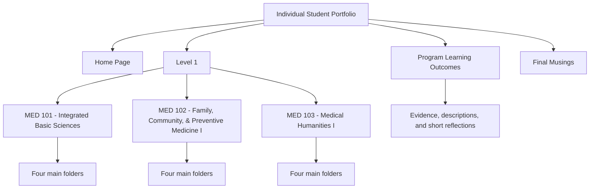
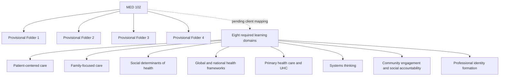

# BukSU-COM Level 1 Academic Content Structure

Phase 1 – Stage 2: Academic Content and Folder Mapping

This document translates the official BukSU-COM Level 1 Portfolio Instructions into an application content structure. It does not create application code or approve folder names that the client has not approved.

## 1. Authority and Mapping Rules

- The original college instructions are the authority for academic content and prescribed questions.
- The client-confirmed structure is the authority for the number of subjects and main folders.
- There are exactly three Level 1 subjects.
- Each subject has exactly four main folders.
- There are exactly twelve main subject folders.
- Home Page, Program Learning Outcomes, and Final Musings are portfolio-wide sections and are not counted among the twelve subject folders.
- The four-folder names for all subjects and the MED 102 domain-to-folder mapping remain pending client clarification.
- Labels such as **Provisional Folder 1** are placeholders only; they are not proposed academic names.

## 2. Academic Hierarchy

## 3. Confirmed Level 1 Subjects and Main Folders

### 3.1 Subjects

| Subject | Official title | Main-folder count | Folder naming status |
|---|---|---:|---|
| MED 101 | Integrated Basic Sciences | 4 | Pending client confirmation |
| MED 102 | Family, Community, & Preventive Medicine I | 4 | Pending client confirmation |
| MED 103 | Medical Humanities I | 4 | Pending client confirmation |

### 3.2 Twelve-folder inventory

The following inventory establishes the required count without inventing academic folder names.

| Subject | Main folder placeholder | Status |
|---|---|---|
| MED 101 | MED101-F01 – 1st Bimonthly – Medical Foundations | Temporary display value; period is the main folder |
| MED 101 | MED101-F02 – 2nd Bimonthly – Knowledge Development | Temporary display value; period is the main folder |
| MED 101 | MED101-F03 – 3rd Bimonthly – Learning Integration | Temporary display value; period is the main folder |
| MED 101 | MED101-F04 – 4th Bimonthly – Year-End Reflection | Temporary display value; period is the main folder |
| MED 102 | Provisional Folder 1 | Name and domain mapping pending |
| MED 102 | Provisional Folder 2 | Name and domain mapping pending |
| MED 102 | Provisional Folder 3 | Name and domain mapping pending |
| MED 102 | Provisional Folder 4 | Name and domain mapping pending |
| MED 103 | Provisional Folder 1 | Name pending |
| MED 103 | Provisional Folder 2 | Name pending |
| MED 103 | Provisional Folder 3 | Name pending |
| MED 103 | Provisional Folder 4 | Name pending |

### 3.3 Count validation

- Subjects: **3**
- Main folders per subject: **4**
- Total main subject folders: **12**

## 4. MED 101 – Integrated Basic Sciences

**Source reference:** Original PDF, pp. 4–5.

The college instructions organize MED 101 into four bimonthly periods. The client confirmed that each bimonthly period is one of the four main folders. Each main folder contains CERAE, Reflections, and Artifacts. The display names remain configurable.

| Academic period | Provisional relationship | Naming status |
|---|---|---|
| 1st Bimonthly | MED 101 / MED101-F01 – 1st Bimonthly – Medical Foundations | Confirmed main-folder relationship; temporary display value |
| 2nd Bimonthly | MED 101 / MED101-F02 – 2nd Bimonthly – Knowledge Development | Confirmed main-folder relationship; temporary display value |
| 3rd Bimonthly | MED 101 / MED101-F03 – 3rd Bimonthly – Learning Integration | Confirmed main-folder relationship; temporary display value |
| 4th Bimonthly | MED 101 / MED101-F04 – 4th Bimonthly – Year-End Reflection | Confirmed main-folder relationship; temporary display value |

### 4.1 1st Bimonthly – CERAE

1. What were your personal expectations upon entering medical school?
2. What did you find easy? What did you find difficult?
3. What was a personal achievement you have attained and see as a personal milestone in this bimonthly? (Provide artifacts)
4. What do you intend to do to improve your grades/study habits/time management/group dynamics, etc.? (Provide artifacts)

**Evidence requirements:** The student documents a personal milestone with supporting artifacts and provides an improvement plan with supporting artifacts. The first two questions document expectations and perceived ease or difficulty.

### 4.2 2nd Bimonthly – CERAE

1. How different was the 2nd Bimonthly to the 1st Bimonthly?
2. What did you find easy? What did you find difficult?
3. What was a personal achievement you have attained and see as a personal milestone in this bimonthly? (Provide artifacts)
4. What do you intend to do to improve your grades/study habits/time management/group dynamics, etc.? (Provide artifacts)

**Evidence requirements:** The student compares the second period with the first, documents a personal milestone with supporting artifacts, and provides an improvement plan with supporting artifacts.

### 4.3 3rd Bimonthly – CERAE

1. What are your realizations now that a semester has passed?
2. What did you find easy? What did you find difficult?
3. What was a personal achievement you have attained and see as a personal milestone in this bimonthly? (Provide artifacts)
4. What do you intend to do to fully realize your goals in the 4th Bimonthly?

**Evidence requirements:** The student documents semester realizations, ease and difficulty, a personal milestone with supporting artifacts, and an action plan for achieving fourth-period goals. The source does not require an artifact for Question 4.

### 4.4 4th Bimonthly – CERAE

1. What were the personal goals that you’ve achieved? What did you find easy and difficult to achieve?
2. What was a personal achievement you have attained and see as a personal milestone in this bimonthly? (Provide artifacts)
3. What significant change have you noted at the end of one whole school year?

**Evidence requirements:** The student documents achieved goals, ease and difficulty, a personal milestone with supporting artifacts, and significant year-end change. The source lists three questions; no fourth question is to be added.

## 5. MED 102 – Family, Community, & Preventive Medicine I

**Source reference:** Original PDF, pp. 5–6.

MED 102 contains eight required learning domains. The client requires four main folders, but the supplied academic source does not define four folder names or a domain grouping. Therefore, the domains are retained as nested academic content under a provisional four-folder shell. No domain is assigned to a folder in this document.

### 5.1 Required domains and source-specified evidence

| Domain | Source-specified supporting evidence |
|---|---|
| Patient-centered care | Patient case analysis identifying biological, psychological, and social factors |
| Family-focused care | Genogram or family assessment with reflection |
| Social determinants of health | Social determinants analysis of a patient or community case |
| Global and national health frameworks | SDG mapping worksheet linking health priorities with Philippine health programs |
| Primary health care and Universal Health Care | Reflection and output from the mock Rural Health Unit activity |
| Systems thinking | Map or causal loop diagram with written analysis |
| Community engagement and social accountability | Community health needs analysis or community-oriented intervention proposal |
| Professional identity formation | Integrative reflection on learning and growth throughout MED 102 |

These are source-specified evidence examples. They do not authorize additional evidence types or a folder grouping.

### 5.2 Prescribed reflection questions for every domain

The following four questions apply to each of the eight domains:

1. **What did I learn?** Identify the most important insight from the activity.
2. **What changed in my understanding?** Explain how the experience challenged or strengthened your previous beliefs about health, illness, or healthcare delivery.
3. **Why does this matter to the people and communities we serve?** Relate your learning to patient, family, or community needs, preferably in the context of Bukidnon.
4. **How will I apply this as a future physician?** Identify a specific action or change in your future approach.

### 5.3 Pending mapping decision

The following must be confirmed by the client before academic content mapping is finalized:

- The exact names of MED 102's four main folders.
- Which of the eight domains are nested under each folder.
- Whether a domain may be represented across more than one folder or must have one primary folder.
- Whether the four folders are intended to represent academic groupings, periods, or another client-defined organization.

Until confirmed, the application content model must preserve all eight domains independently and must not assume two domains per folder.

## 6. MED 103 – Medical Humanities I

**Source reference:** Original PDF, pp. 6–8.

MED 103 contains four bimonthly periods. The four-period-to-folder relationship below is a provisional alignment only.

| Academic period and official theme | Provisional relationship | Naming status |
|---|---|---|
| 1st Bimonthly – Learning Identity, Historical Perspectives, and Humanistic Foundations | MED 103 / Provisional Folder 1 | Proposed period alignment; folder name pending |
| 2nd Bimonthly – Patient-Centered Relationships, Advocacy, and Cultural Understanding | MED 103 / Provisional Folder 2 | Proposed period alignment; folder name pending |
| 3rd Bimonthly – Professional Identity, Ethics, Accountability, and Well-Being | MED 103 / Provisional Folder 3 | Proposed period alignment; folder name pending |
| 4th Bimonthly – Ethical Leadership, Disaster Preparedness, Social Responsibility, and Year-End Integration | MED 103 / Provisional Folder 4 | Proposed period alignment; folder name pending |

### 6.1 1st Bimonthly – Learning Identity, Historical Perspectives, and Humanistic Foundations

1. How have the principles of andragogy, learning, and memory influenced the way you study and take responsibility for your learning as a medical student? Reflect on one study practice you changed or need to change, and explain how this relates to your “My Learning Philosophy” and “My Why.”
2. Which historical development or medical tradition—from early medicine through Philippine medicine—most challenged or enriched your understanding of healing and the role of the physician? How did it influence your respect for scientific evidence, patients’ beliefs, and the social context of care?
3. As you were introduced to the patient–doctor relationship, what personal assumption about being a “good doctor” did you begin to question? Using a class discussion, scenario, or observed interaction, explain how empathy, respect, trust, and professional responsibility may influence a patient’s experience.
4. What personal milestone and what difficulty best describe your development during this bimonthly? Identify an artifact that demonstrates your learning and formulate one specific, realistic action to improve your self-directed learning, reflection, or humanistic attitudes in the next bimonthly.

**Evidence and development requirements:** Question 4 requires an artifact demonstrating learning, a personal milestone and difficulty, and one specific realistic improvement action.

### 6.2 2nd Bimonthly – Patient-Centered Relationships, Advocacy, and Cultural Understanding

1. Recall a patient narrative, role-play, or learning scenario in which a patient’s feelings, beliefs, circumstances, or expectations differed from the physician’s assumptions. How did listening, empathy, nonjudgmental communication, and trust-building change your interpretation of the patient’s behavior? What would you say or do differently now?
2. When a patient has difficulty understanding, accepting, or carrying out a proposed care plan, how can a physician advocate for and empower the patient without undermining autonomy? Reflect on an example and explain how patient feedback could be used to improve communication, quality of care, or the patient’s experience.
3. How have the discussions on cultural integration, diversity, and planetary/environmental health changed the way you understand illness and access to care? Consider local Bukidnon communities, including Indigenous Peoples where relevant, and examine how culture, living conditions, environment, or personal bias may affect respectful and equitable clinical decisions.
4. What learning activity or artifact most clearly demonstrates your progress in patient-centered communication, cultural humility, or advocacy? Describe what was challenging, the feedback or realization that mattered most, and a specific plan for practicing these competencies more consistently.

**Evidence and development requirements:** Question 4 identifies a learning activity or artifact and requires a specific improvement plan. The source does not impose a separate artifact requirement on Questions 1–3.

### 6.3 3rd Bimonthly – Professional Identity, Ethics, Accountability, and Well-Being

1. How has your understanding of medical professionalism changed from viewing it as proper conduct to seeing it as a continuing commitment to patients, colleagues, and society? Reflect on a concrete situation in which your attitudes, integrity, respect, or sense of responsibility were tested.
2. Reflect on a simulated or observed professional dilemma involving compassion, honesty, confidentiality, accountability, a professional lapse, or peer behavior. Which ethical or professional principles—including those discussed in relation to the Hippocratic Oath and PMA/PRC standards—guided your judgment? What would you do, and why?
3. What did patient history-taking experiences or exercises in Pediatrics, OB-GYN, Internal Medicine, or Surgery teach you about adapting communication to different patients and working respectfully with health care teams? Identify a communication challenge, possible bias, or cultural consideration and explain how you would respond more effectively.
4. What evidence best demonstrates your growth in professionalism, teamwork, and self-awareness during this bimonthly? Explain how you will respond to feedback, address an identified weakness, and practice healthy self-care while maintaining professional responsibilities.

**Evidence and development requirements:** Question 4 asks for evidence of growth and an action concerning feedback, weakness, and self-care. The source does not prescribe a separate artifact type.

### 6.4 4th Bimonthly – Ethical Leadership, Disaster Preparedness, Social Responsibility, and Year-End Integration

1. What did your experiences in group work, leadership activities, or management discussions reveal about your strengths and limitations as a future member or leader of a health care team? How would you use ethical leadership, collaboration, and quality-improvement principles to promote patient safety and resolve a team challenge?
2. Reflect on a disaster-risk-reduction activity, simulation, or scenario relevant to a Philippine community. What did it teach you about preparedness, coordinated response, risk communication, and recovery? Explain how you would balance immediate patient needs, limited resources, and care for vulnerable community members.
3. How did your Student Social Responsibility Project or other community-oriented learning experience deepen your understanding of service, social accountability, and the core values of BukSU-COM? Identify one result or limitation, whose perspective you may have overlooked, and a specific improvement you would propose. (Provide an artifact.)
4. Looking back over the entire year of Medical Humanities I, how has your understanding of “My Why,” “My Learning Philosophy,” and “The Good Doctor” changed? Identify your most significant growth in empathy, professionalism, leadership, cultural humility, and social responsibility. What evidence supports this growth, and what concrete commitments will guide you in Level II?

**Evidence and development requirements:** Question 3 explicitly requires an artifact. Question 4 requires evidence supporting year-end growth and concrete commitments for Level II. The source does not specify a separate artifact format for the other questions.

## 7. Portfolio-Wide Academic Sections

These sections are outside the twelve subject-folder count.

### 7.1 Home Page

The Home Page contains:

1. **All About Me** — a three-quarter portrait photograph and a brief personal introduction.
2. **My Learning Philosophy.**
3. **My Why.**
4. **The Good Doctor.**

The source reference is the original PDF, p. 4.

### 7.2 Program Learning Outcomes

The portfolio documents evidence related to all eleven PLOs:

1. Demonstrate clinical competence.
2. Communicate effectively.
3. Lead and manage health care teams.
4. Engage in research activities.
5. Collaborate within interprofessional teams.
6. Utilize systems-based approach to healthcare.
7. Engage in continuing personal and professional development.
8. Adhere to ethical, professional, and legal standards.
9. Demonstrate nationalism, internationalism and dedication to service.
10. Practice the principles of social accountability.
11. Apply the core values of BukSU-COM to the medical practice in the communities.

Each PLO documentation entry supports:

- Relevant supporting artifacts.
- An artifact description.
- A short reflection explaining relevance and significance.

The portfolio records evidence; an artifact does not automatically establish formal PLO attainment. Source reference: original PDF, pp. 8–9.

### 7.3 Final Musings for Level 1

Final Musings contains these five prescribed questions:

1. Has your learning philosophy changed?
2. Has your reason to pursue medicine changed?
3. What made them change? What made them remain as is?
4. How do you see your entire Level 1 journey contribute to your goal as a good doctor?
5. What was the single most important thing you learned in Level 1?

Source reference: original PDF, p. 9.

## 8. Cross-Cutting Evidence Rules

These requirements apply to supporting artifacts throughout the portfolio:

- Evidence must represent the student's actual work, experience, or contribution.
- Evidence must be relevant to learning and, where applicable, one or more PLOs.
- The student must explain why an artifact was selected and what it demonstrates.
- Entries and artifacts must be professionally presented.
- Patient names, faces, identifying dates, record numbers, and other identifying details must be removed.
- Required permissions must be obtained for clinical or community material.
- References, collaborators, and any use of artificial intelligence must be acknowledged.

## 9. Proposed and Unresolved Folder Mappings

### Proposed structural alignments

- MED 101: Provisional Folders 1–4 align in order with the four bimonthly periods.
- MED 103: Provisional Folders 1–4 align in order with the four bimonthly periods.
- MED 102: Four provisional folders exist, but no domain is assigned to any folder.

These alignments are organizational proposals only. They are not client-approved folder names.

### Required client decisions

1. Approve the exact names of all four MED 101 folders.
2. Approve the exact names of all four MED 102 folders.
3. Approve the exact names of all four MED 103 folders.
4. Approve the mapping of all eight MED 102 domains to the four folders.
5. Clarify whether the four-folder structure is intended to represent periods, academic groupings, or another organization for each subject.

## 10. Validation Checklist

- [x] Exactly three Level 1 subjects are documented.
- [x] Exactly four main folders are listed for MED 101.
- [x] Exactly four main folders are listed for MED 102.
- [x] Exactly four main folders are listed for MED 103.
- [x] Twelve total main subject folders are listed.
- [x] All eight MED 102 domains are preserved.
- [x] All four MED 102 reflection questions are preserved exactly.
- [x] All four MED 101 periods and their prescribed questions are included.
- [x] All four MED 103 periods and their prescribed questions are included.
- [x] All eleven PLOs are included.
- [x] All five Final Musings questions are included.
- [x] Home Page requirements are included.
- [x] Supporting artifact and academic-integrity requirements are included.
- [x] No academic folder names or MED 102 domain groupings were invented.

