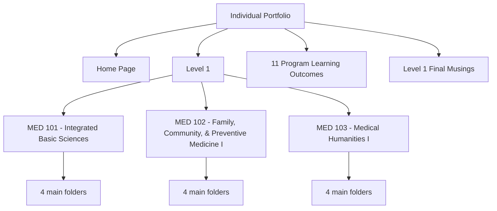

# Phase 1 Requirements Summary

## 1. Project Overview

The BukSU-COM Student Learning and Reflective Digital Portfolio is a private, custom-developed web application for one medical student. It documents academic learning, reflection, supporting evidence, professional development, and evidence related to the eleven BukSU-COM Program Learning Outcomes.

The original college instructions remain authoritative for academic content, reflection questions, evidence standards, confidentiality, and academic integrity. Client decisions establish the individual scope, Level 1 subject set, folder count, ownership, access model, privacy, custom-development approval, and future-level objective.

## 2. Confirmed Scope

- Individual student portfolio.
- Initial coverage: Level 1.
- Exactly three Level 1 subjects.
- Exactly four main folders per subject and twelve total.
- Mandatory authentication.
- Private portfolio access.
- Student full management of their own content.
- Authorized instructor access.
- Instructors may create separate reviews and feedback for authorized portfolios, but cannot edit, upload, delete, grade, or alter original student content.
- Required reflections, artifacts, PLO documentation, Final Musings, and responsive web access.
- Future academic-level support without including future-level content in Version 1.0.

The approved technical direction is Supabase PostgreSQL on the Free Plan, Supabase Auth, private Supabase Storage, and PostgreSQL RLS, with React + Vite, Tailwind CSS, Framer Motion, and Lucide React on the frontend. This does not change the academic structure or access rules.

## 3. Final Academic Structure

### Subjects and twelve main folders

| Subject | Main folders | Academic content |
|---|---:|---|
| MED 101 – Integrated Basic Sciences | 4 | Four bimonthly periods with CERAE questions and source-specified artifacts |
| MED 102 – Family, Community, & Preventive Medicine I | 4 | Eight learning domains with four recurring reflection questions per domain |
| MED 103 – Medical Humanities I | 4 | Four themed bimonthly periods with CERAE questions and source-specified evidence |
| **Total** | **12** | **Level 1 subject folders** |

Stable folder IDs and temporary display values are now recorded for all twelve folders. MED 101 and MED 103 use period-aligned display values. MED 102 uses a proposed display grouping that is not yet client-approved; all eight domains remain separate sections inside their parent folders.

## 4. Roles

### Student

The student manages their own profile, Home Page sections, reflections, artifacts, PLO evidence, and Final Musings. The student does not administer institutional users or alter the approved curriculum structure.

### Authorized faculty

Faculty must authenticate and receive explicit authorization. They may view authorized content only. Backend authorization must reject all faculty write operations, including direct API attempts. Faculty feedback, comments, and grading are outside Version 1.0.

## 5. Functional Requirements Summary

The requirements baseline defines:

1. Authentication and account access.
2. Role-based access control.
3. Student profile management.
4. Home Page and personal sections.
5. Academic level management.
6. Subject management.
7. Subject folder management.
8. Learning period and domain management.
9. Reflection management.
10. Academic artifact management.
11. Program Learning Outcomes documentation.
12. Final Musings.
13. Faculty read-only portfolio access.
14. A conditional progress dashboard.
15. Privacy and protected file access controls.

Functional IDs are FR-001 through FR-015 in [REQUIREMENTS_ANALYSIS.md](./REQUIREMENTS_ANALYSIS.md).

## 6. Non-Functional Requirements Summary

The baseline covers:

- Security: authentication, backend authorization, private storage, file validation, protected downloads, and explicit failures.
- Privacy: restricted access, student-information protection, patient confidentiality, permissions, and academic-integrity guidance.
- Usability: understandable academic navigation, contextual reflection forms, artifact guidance, and clear destructive-action outcomes.
- Responsiveness: desktop, tablet, and mobile operation.
- Maintainability: modular code, reusable services/components, consistent authorization boundaries, and maintainable academic content.
- Expandability: future levels, subjects, configurable folders, and different learning structures without weakening access controls.

Non-functional IDs are NFR-001 through NFR-025.

## 7. Security and Privacy Requirements

- Login is required for portfolio and artifact access.
- Backend authorization must enforce identity, ownership, role, and faculty assignment.
- Supabase Auth, PostgreSQL RLS, and private Storage policies must enforce the same access decisions at the service boundary.
- Frontend visibility is never sufficient authorization.
- Instructor write operations on original student content must be rejected even through direct API requests.
- Artifacts must use private storage and authorized downloads.
- Patient names, faces, identifying dates, record numbers, and other identifiable details must not be uploaded.
- Clinical/community permissions, artifact relevance, authenticity, professionalism, references, collaborators, and AI use must be addressed.
- The application must not automatically declare PLO attainment from uploaded evidence.

## 8. Main Exclusions

- Multiple-student institutional administration.
- Institutional curriculum or user administration.
- Faculty comments, feedback, editing, deletion, uploading, or grading.
- AI-generated reflections.
- Real-time messaging.
- Native mobile application.
- Actual Level 2 and later academic content.
- Public portfolio access.
- Automatic formal PLO assessment.

## 9. Future Expansion Objectives

The requirements support adding later academic levels, subjects, folders, learning periods, domains, reflections, artifacts, and outcome evidence without replacing the Level 1 structure. Future expansion must preserve private access, student ownership, faculty read-only behavior, confidentiality, and academic integrity.

## 10. Outstanding Client Decisions

1. Permanent approval or replacement of the temporary display names for all four folders under each subject.
2. Approval or revision of MED 102’s proposed mapping of eight domains into four folders.
3. Faculty authorization list and assignment process.
4. Whether faculty view the entire assigned portfolio or selected sections.
5. Account creation and password recovery.
6. Artifact file formats and maximum upload size.
7. Hosting, domain, Supabase project configuration, backup frequency, retention, and recovery.
8. Draft/completed states and progress-dashboard calculation/visibility.
9. Student revision/deletion behavior after faculty viewing.
10. Retention and account deactivation after level changes or graduation.

## 11. Phase 1 Completion Assessment

Phase 1 requirements documentation is complete:

- Source review is documented.
- Academic structure is documented.
- Functional and non-functional requirements have unique IDs.
- Roles, permissions, scope, risks, and acceptance criteria are documented.
- Traceability links connect source/client requirements to modules and acceptance criteria.
- The fixed academic counts and content requirements have been validated.
- No application source code, database migration, UI design, dependency installation, or technical architecture was created.

Requirements documentation completion does not mean all implementation decisions are approved. The unresolved client decisions must be settled before final technical design and implementation of affected areas.

## 12. Recommendation for Phase 2

Proceed to Phase 2 only after developer/client review of this requirements baseline and resolution or explicit deferral of the folder names, MED 102 mapping, faculty authorization scope, artifact restrictions, operational storage/backup decisions, and dashboard behavior. Phase 2 should begin with approved technical design work; it should not silently decide unresolved academic requirements.

