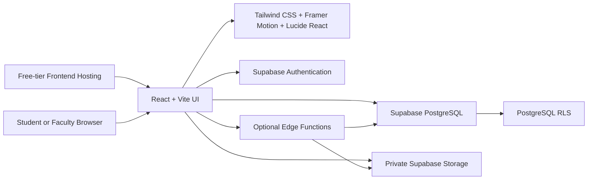
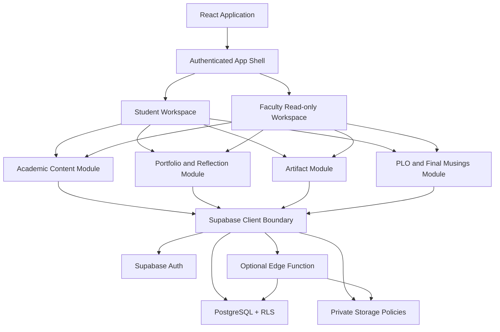
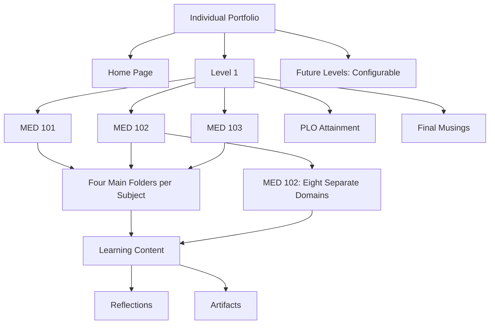
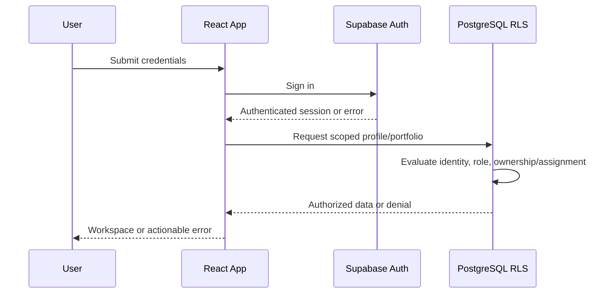
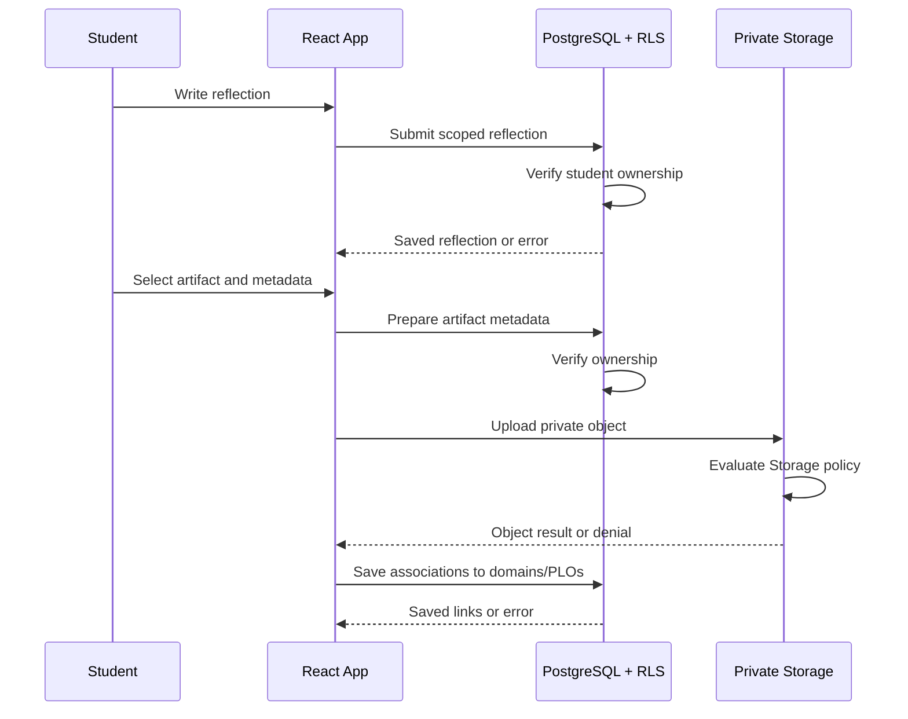
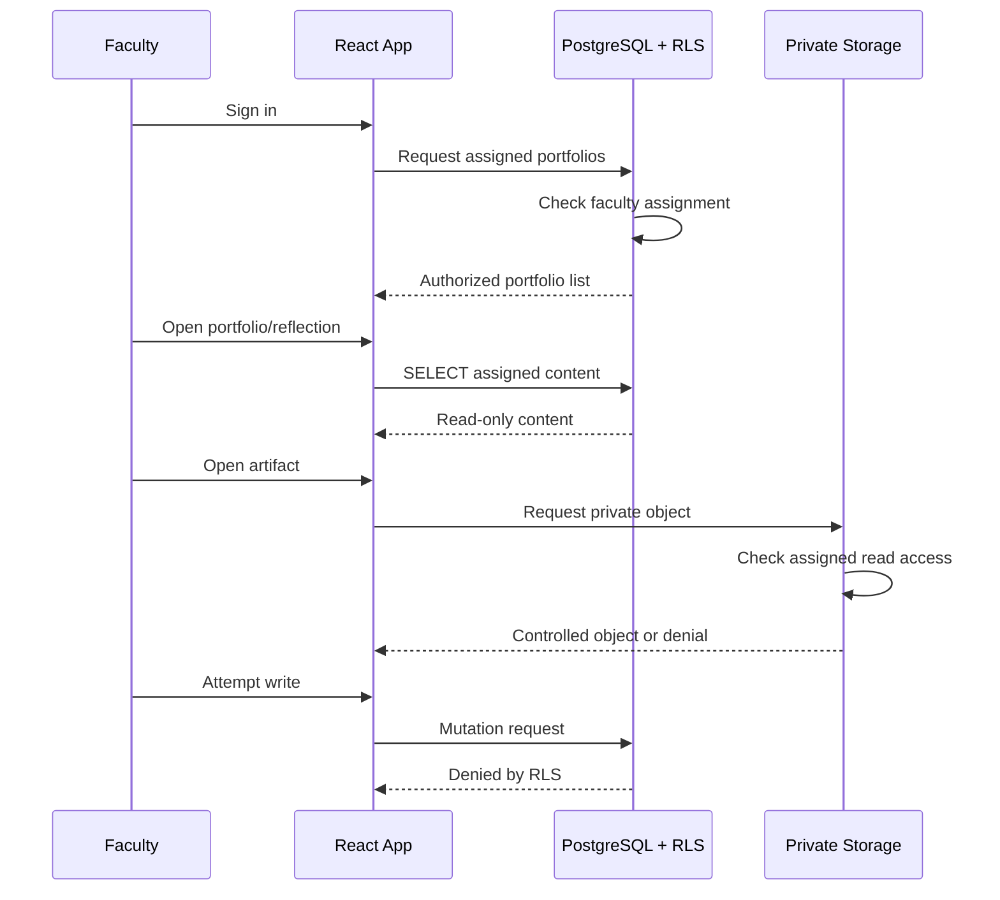

# System Architecture Diagrams

## Phase 3 – Stage 2

These Mermaid diagrams describe the high-level design. They are not database ERDs, migrations, or implementation diagrams.

## 1. Overall System Architecture

## 2. Application Component Architecture

## 3. Academic Content Hierarchy

## 4. Authentication Flow

## 5. Reflection and Artifact Data Flow

## 6. Faculty Read-only Access Flow

