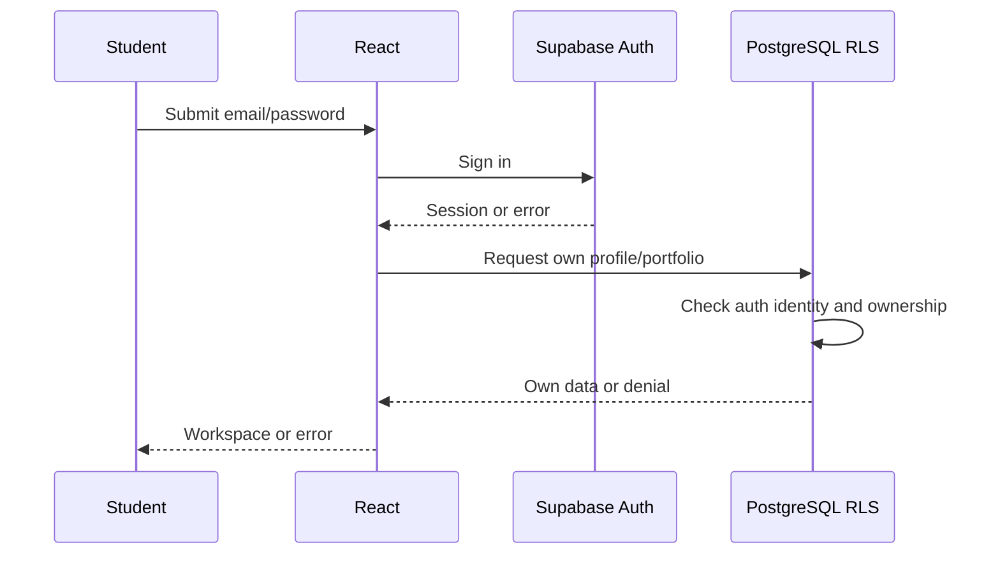
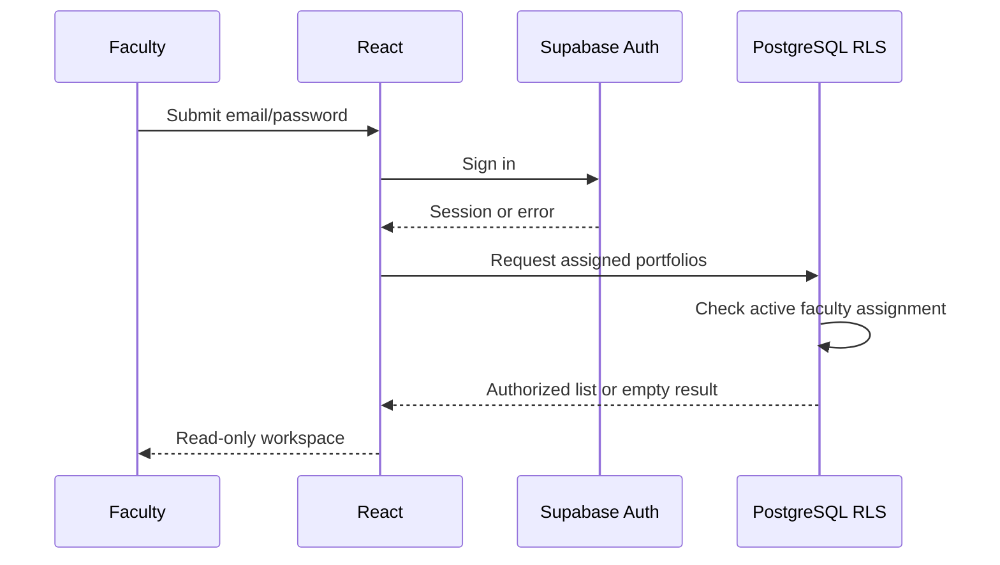
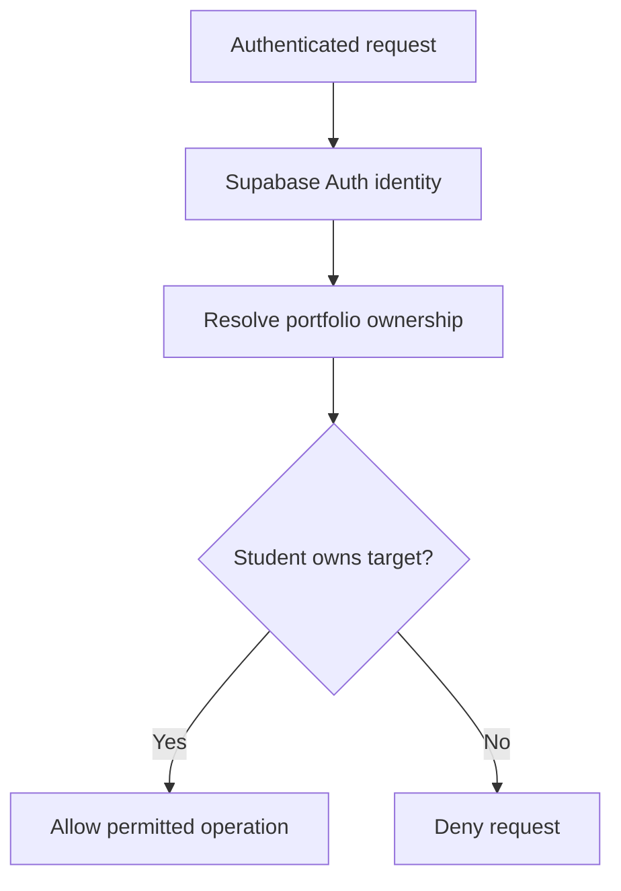
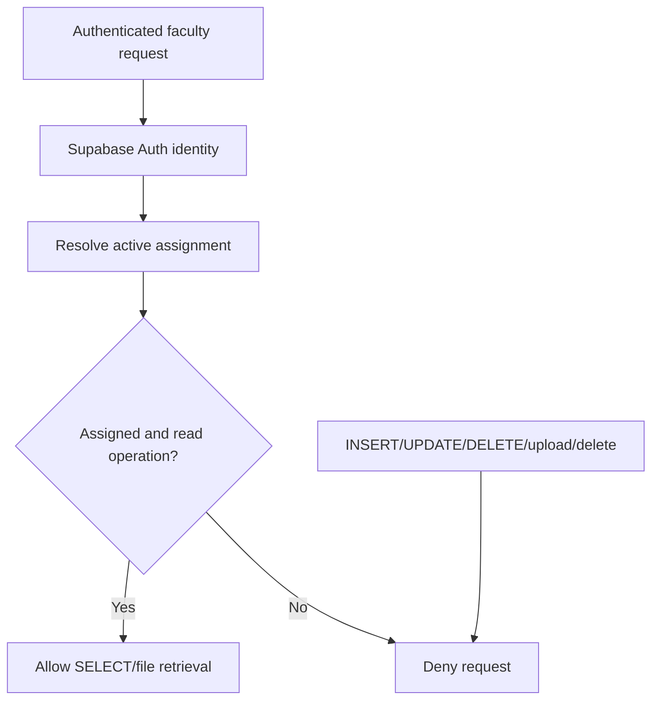
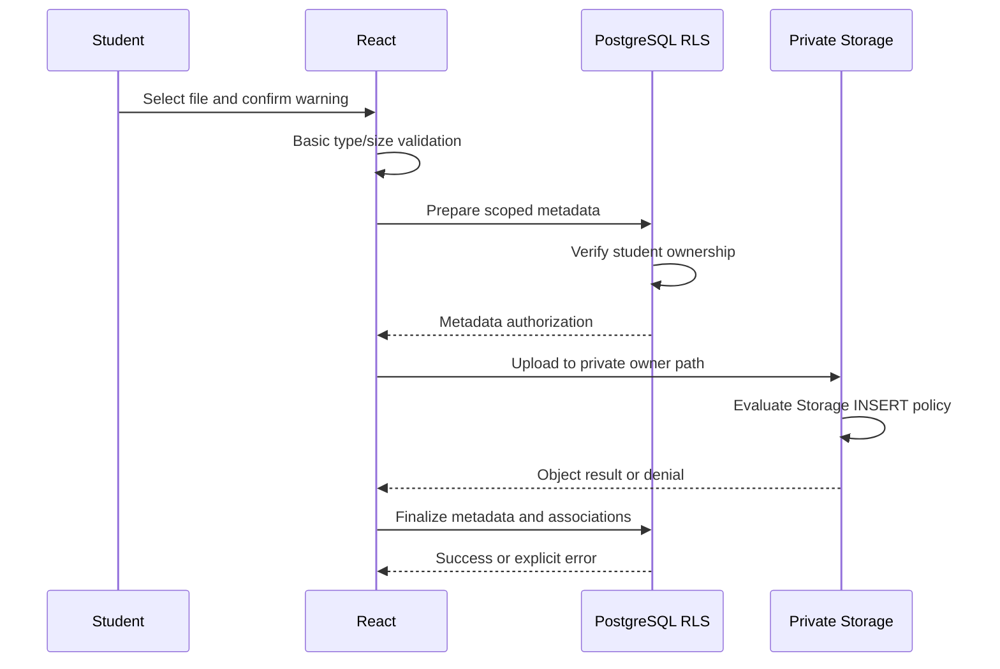
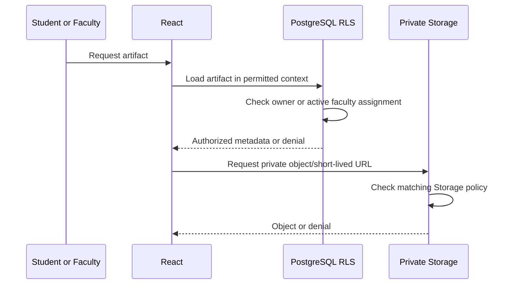
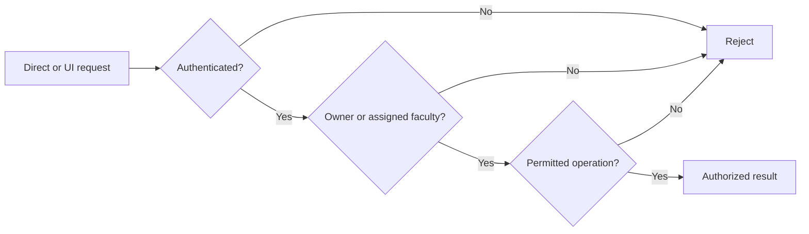

# Authorization and Data Flow

## Phase 3 – Stage 3

The frontend improves usability; Supabase Auth, PostgreSQL RLS, and Storage policies enforce security.

## 1. Student Authentication

## 2. Faculty Authentication

## 3. Student Portfolio Authorization

## 4. Faculty Read-only Authorization

## 5. Secure Artifact Upload

## 6. Secure Artifact Retrieval

## 7. Unauthorized Access Rejection

## 8. Check Locations

| Check | Frontend | Supabase Auth | PostgreSQL RLS | Storage policy |
|---|---:|---:|---:|---:|
| Login | UX gate | Identity/session | Denies unauthenticated rows | Denies unauthenticated objects |
| Student ownership | Display only | Identity | Authoritative | Authoritative for objects |
| Faculty assignment | Display only | Identity | Authoritative | Authoritative for objects |
| Faculty read-only | Hide controls | Identity only | Deny mutations | Deny upload/replace/delete |
| File type/size | Early validation | No | Metadata checks as approved | Object policy and limits |
