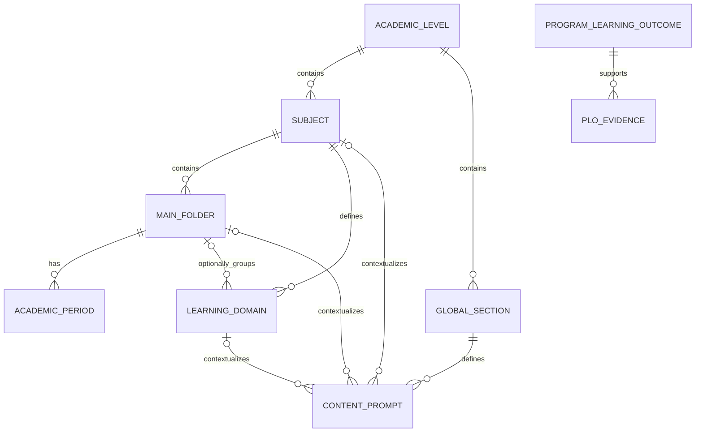

# Academic Structure ERD

## Constraints

- Level 1 contains exactly MED 101, MED 102, and MED 103.
- Each has four main-folder records.
- MED 102 has eight distinct `LEARNING_DOMAIN` records.
- A parent folder is organizational only; it must not merge or hide a domain.
- MED 101 and MED 103 period titles and prompts remain source-preserving.
- Home Page, PLO Attainment, and Final Musings are global sections.
- Future levels add rows, not new schema tables.
