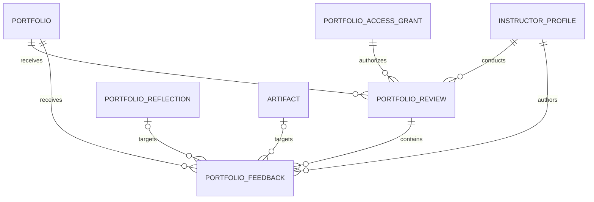

# Instructor Reviews and Feedback ERD

## Constraints

- A review has one portfolio and one reviewing instructor.
- The instructor must have an active grant when creating the review or feedback.
- Feedback may be general or target one reflection/artifact, but the target must belong to the same portfolio.
- Students can read feedback for their own portfolio.
- Feedback cannot update or delete the original reflection, answer, artifact, or PLO evidence.
- Review and feedback history requires timestamps and an approved lifecycle policy.
- Draft review states, instructor editing after publication, student replies, and notifications are unresolved.
