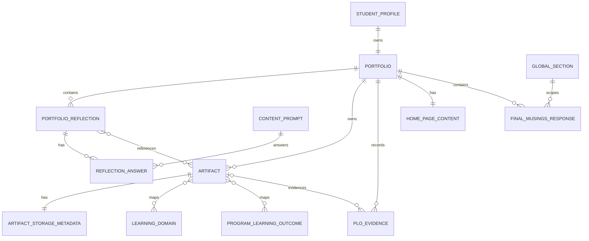

# Portfolio Content ERD

Artifacts are stored once in private Supabase Storage. Metadata is relational, and junction entities allow one artifact to support multiple reflections, domains, and PLOs without duplicate files. All original content is owned by the student portfolio.
