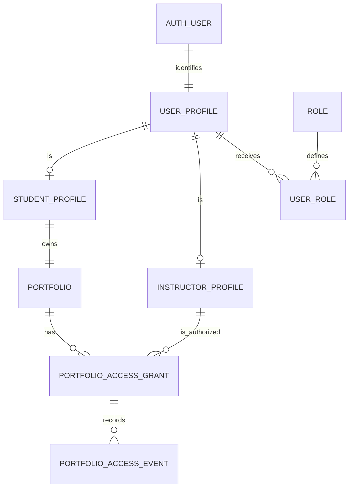

# User and Portfolio Ownership and Access ERD

## Relationship Rules

- Ownership is one-to-one from student to portfolio.
- Authorization is many-to-many through `PORTFOLIO_ACCESS_GRANT`.
- A grant includes conceptual grantor, grant date, status, and optional revocation date.
- Only an active grant permits instructor reads and review/feedback creation.
- A registered or verified instructor without a grant has no portfolio access.
- Grant history is retained for audit but revoked history never authorizes access.
