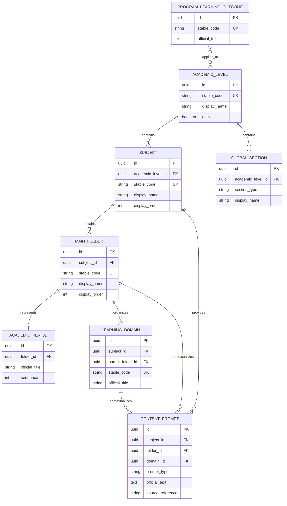

# Academic Structure ERD

## Phase 4 – Stage 2

## Constraints

- Level 1 contains exactly three subjects and four main folders per subject.
- MED 102 contains eight `LEARNING_DOMAIN` records, not four.
- `parent_folder_id` remains configurable/provisional for MED 102.
- Stable codes do not change when display labels change.
- Global sections are separate from subject folders.
- Future levels may use different period/domain arrangements.
