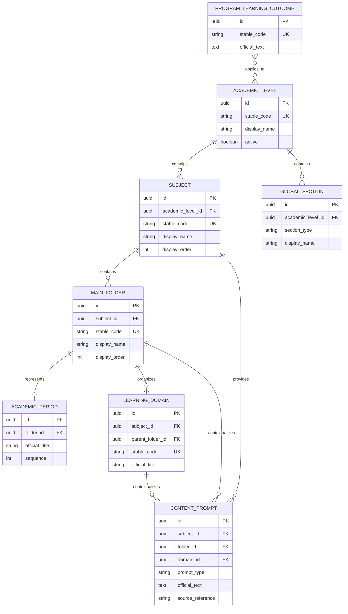

# Academic Structure ERD

## Phase 4 – Stage 2

## Constraints

- Current structure: MED 101 and MED 103 each have four Bimonthly sections; MED 102 has eight independent domains and no parent-folder layer.
- MED 102 contains eight `LEARNING_DOMAIN` records, not four.
- `parent_folder_id` remains configurable/provisional for MED 102.
- Stable codes do not change when display labels change.
- Global sections are separate from subject folders.
- Future levels may use different period/domain arrangements.

## Current MED 102 structure (13 November 2026)

The official instructions PDF, section 2.2 (pp. 5-6), defines eight independent MED 102 domains, with required evidence, competency descriptions, one shared four-question reflection guide, and pertinent artifacts. MED 102 has no four-parent-folder requirement. Earlier proposed-parent and unresolved-grouping text in this document is superseded. See docs/phase-2-academic-content/03_MED102_STRUCTURE_FINALIZATION.md for exact wording and the database representation review.
