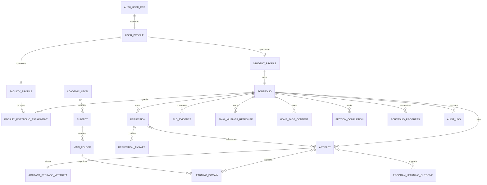

# System Entity Relationship Diagram

## Phase 4 – Stage 2

Conceptual Mermaid ERD only. It is not executable schema.

## Key Constraints

- `AUTH_USER_REF` references the Supabase Auth user ID.
- A portfolio has one student owner.
- Faculty assignments are active/revocable and never grant writes.
- Content and junction rows resolve to one portfolio owner.
- Storage bytes remain outside PostgreSQL.
