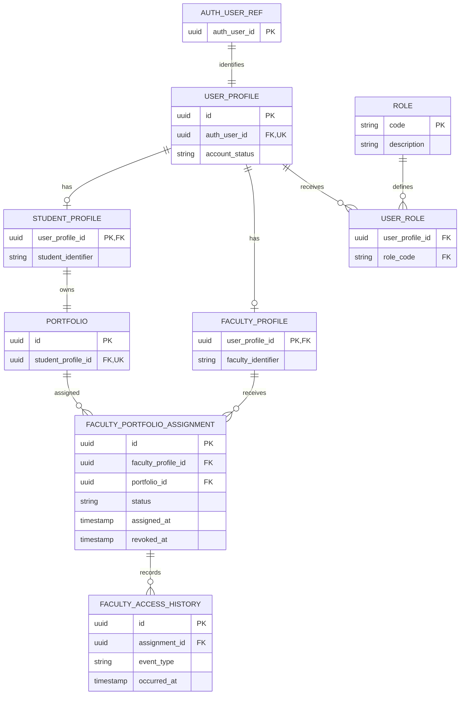

# User and Faculty Access ERD

## Phase 4 – Stage 2

Only trusted provisioning creates roles and assignments. Active assignments permit read access only; revoked assignments no longer satisfy authorization checks.
