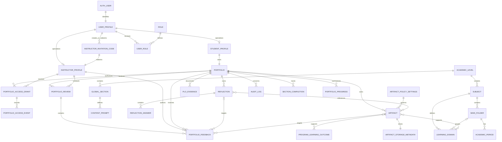

# Final Database ERD

`AUTH_USER` is managed by Supabase Auth. Current access depends only on active portfolio grants, not registration or invitation-code redemption.

`ARTIFACT_POLICY_SETTINGS` is configurable policy data. Its allowed formats, size limits, retention, and permanent-deletion values remain institution-dependent.
