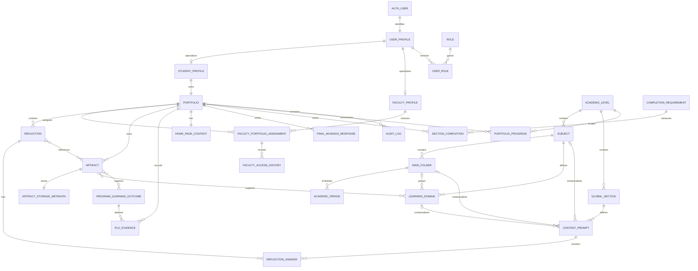

# Final Database ERD

The following Mermaid ERD is the consolidated logical model. It shows the principal entities and junctions; detailed columns are in the final dictionary.

`AUTH_USER` is Supabase Auth, not an application table. Faculty relationships are read-only by policy. Global sections remain separate from subject hierarchy.

Current structure: MED 101 and MED 103 each have four Bimonthly sections; MED 102 has eight independent domains and no parent-folder layer.

## Current MED 102 structure (13 November 2026)

The official instructions PDF, section 2.2 (pp. 5-6), defines eight independent MED 102 domains, with required evidence, competency descriptions, one shared four-question reflection guide, and pertinent artifacts. MED 102 has no four-parent-folder requirement. Earlier proposed-parent and unresolved-grouping text in this document is superseded. See docs/phase-2-academic-content/03_MED102_STRUCTURE_FINALIZATION.md for exact wording and the database representation review.
